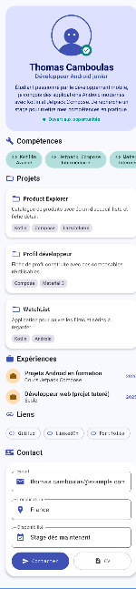

# Profil développeur DS

Application Android réalisée avec **Kotlin** et **Jetpack Compose** dans le cadre du devoir
« Amélioration UI de l'application Profil développeur ».

## Description

L'application affiche le profil d'un développeur Android junior en recherche de stage :
nom, rôle, courte description, avatar, compétences, projets, expériences et zone de contact
avec deux actions (« Contacter » et « CV »).
Toutes les données sont **locales**, écrites directement dans le code Kotlin
(`data/DeveloperProfile.kt`). Les boutons appellent des *callbacks* vides.

## Capture d'écran

| Thème clair | Thème sombre |
|---|---|
|  |  |

## Composants Compose utilisés

| Composant | Utilisation |
|---|---|
| `Text` | Nom, rôle, description, titres de section, contenu des cartes |
| `Button` / `OutlinedButton` | Actions « Contacter » et « CV » |
| `Icon` | Titres de section, compétences, projets, expériences, champs de contact, badge |
| `Image` | Avatar placeholder (vector drawable `avatar_placeholder.xml`) |
| `Card` | `ProjectCard` et `ContactSection` |
| `OutlinedTextField` (`readOnly = true`) | Email, localisation et disponibilité |
| `Surface` | En-tête du profil, chips de compétences, tags de technologies, badge |
| `Scaffold` | Structure de l'écran dans `MainActivity` |

## Layouts utilisés

- **`Column`** : structure verticale de l'en-tête, des cartes et de la zone de contact.
- **`Row`** : titre de section (icône + texte), `ExperienceItem`, tags de technologies, boutons d'action.
- **`Box`** : avatar avec un badge « disponible » superposé en bas à droite (`ProfileAvatar`).
- **`Spacer`** : espacements entre les éléments (`height`, `width`, et `weight` pour les boutons).
- **`Surface`** : zone d'en-tête teintée avec `primaryContainer`, cohérente avec le thème.

## Listes : `LazyColumn` et `LazyRow`

- **`LazyColumn`** (`ui/ProfileScreen.kt`) : l'écran entier est une `LazyColumn`. Chaque section
  est un `item { }`, et les **projets** et **expériences** sont affichés avec
  `items(items = ..., key = { ... })` : chaque élément utilise un composable réutilisable
  (`ProjectCard`, `ExperienceItem`). La clé stable (`id`) permet à Compose d'identifier chaque élément.
- **`LazyRow`** (`SkillsRow`) : liste horizontale défilable des compétences, chaque élément étant
  rendu par le composable réutilisable `SkillChip` (nom + niveau).

## Choix du thème

Le thème `ProfilDeveloppeurTheme` (`ui/theme/`) personnalise les trois piliers de Material 3 :

- **`MaterialTheme.colorScheme`** : une palette **indigo** (couleur principale, « tech » et sérieuse)
  avec un accent **sarcelle** (compétences, disponibilité) et un **ambre** tertiaire (expériences).
  Le schéma clair utilise des teintes foncées sur fond très clair ; le schéma sombre reprend les
  mêmes teintes éclaircies sur fond gris-bleu foncé pour garder un bon contraste.
  Les couleurs dynamiques sont volontairement désactivées pour garder une identité identique partout.
- **`MaterialTheme.typography`** : titres en gras (SansSerif), textes courants lisibles, et police
  **Monospace** pour les noms de compétences afin d'évoquer le code.
- **`MaterialTheme.shapes`** : coins arrondis progressifs (8 dp pour les petits éléments, 16 dp pour
  les cartes, 24 dp pour l'en-tête) et forme « pilule » (`extraLarge`) pour les chips.
- **Clair / sombre** : le thème suit `isSystemInDarkTheme()` et peut être forcé via le paramètre
  `darkTheme`, ce qu'utilisent les previews.

## Previews

- `ProfileScreenLightPreview` et `ProfileScreenDarkPreview` : écran complet en clair et en sombre.
- `ProfileHeaderPreview`, `SkillChipPreview`, `ProjectCardPreview`, `ContactSectionPreview` :
  composants isolés.

## Structure du projet

```
app/src/main/java/com/example/tpjetpackcompose/
├── MainActivity.kt
├── data/DeveloperProfile.kt        # modèles + données locales
└── ui/
    ├── ProfileScreen.kt            # écran (LazyColumn) + previews clair/sombre
    ├── components/
    │   ├── ProfileHeader.kt        # Surface, Box, Image, badge
    │   ├── SkillComponents.kt      # SectionTitle, SkillChip, SkillsRow (LazyRow)
    │   ├── ProjectComponents.kt    # ProjectCard, TechnologyTag, ExperienceItem
    │   └── ContactSection.kt       # OutlinedTextField readOnly + boutons
    └── theme/                      # Color.kt, Type.kt, Theme.kt
```

## Quelles notions du chapitre Compose UI avez-vous réutilisées dans cette application ?

J'ai réutilisé les **composants fondamentaux** (`Text`, `Button`, `Icon`, `Image`, `Card`,
`OutlinedTextField` en lecture seule), les **layouts** (`Column`, `Row`, `Box` pour superposer un
badge sur l'avatar, `Spacer`, `Surface`), les **listes modernes** avec une `LazyColumn` pour l'écran
et une `LazyRow` pour les compétences, en affichant chaque élément via un **composable réutilisable**
(`SkillChip`, `ProjectCard`, `ExperienceItem`). J'ai aussi appliqué **Material Design 3** en
personnalisant `colorScheme`, `typography` et `shapes`, avec un **thème clair et un thème sombre**
vérifiés grâce aux previews. Enfin, j'ai conservé les bonnes pratiques du premier devoir : paramètres,
`Modifier` passé en argument, *callbacks* et données locales.
