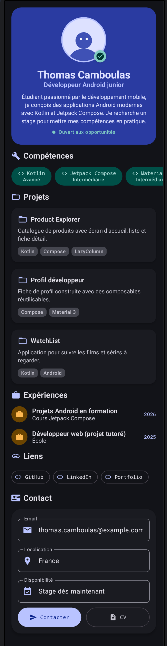

# Profil développeur DS

## C'est quoi ?

Une petite application Android qui présente mon profil de développeur, un peu comme un CV
interactif. On y trouve qui je suis, ce que je sais faire, mes projets, mes expériences,
mes liens et un moyen de me contacter.

C'est la suite du premier devoir « Profil développeur » : l'idée était de reprendre la fiche
de base et de la rendre plus propre et plus agréable à regarder. Toutes les informations
sont écrites directement dans le code, il n'y a pas d'internet ni de base de données derrière.

## Aperçu

| Mode clair | Mode sombre |
|---|---|
|  |  |

## Les composants que j'ai utilisés

- **Text** pour tous les textes : mon nom, mon rôle, les descriptions…
- **Image** pour la photo de profil (un avatar dessiné en attendant une vraie photo)
- **Icon** pour accompagner les titres et les infos (un petit dossier pour les projets, une enveloppe pour l'email…)
- **Button** pour les boutons « Contacter » et « CV »
- **Card** pour regrouper les projets et la partie contact dans des cartes
- **OutlinedTextField** en lecture seule pour afficher mon email, ma ville et ma disponibilité
- **AssistChip** pour les liens GitHub, LinkedIn et Portfolio

## Comment l'écran est organisé

- **Column** pour empiler les éléments les uns sous les autres
- **Row** pour mettre des éléments côte à côte, comme une icône à côté d'un titre ou les deux boutons
- **Box** pour poser un petit badge « disponible » par-dessus la photo de profil
- **Spacer** pour laisser respirer les éléments
- **Surface** pour le bandeau coloré en haut avec ma présentation

## Les listes

Tout l'écran est une **LazyColumn** : on fait défiler le profil de haut en bas, et les
projets et les expériences s'affichent l'un après l'autre.

Pour les compétences et les liens, j'ai utilisé des **LazyRow** : ce sont des petites bandes
qu'on fait défiler de gauche à droite.

Chaque élément d'une liste utilise toujours le même petit composant (`SkillChip`,
`ProjectCard`, `ExperienceItem`, `LinkChip`). Pour ajouter un projet, il suffit donc
d'ajouter une ligne dans les données.

## Le thème

J'ai choisi un **bleu indigo** comme couleur principale, parce que ça fait sérieux et « tech »,
avec une touche de **vert** pour ce qui est positif (les compétences, la disponibilité).

L'application marche en **mode clair et en mode sombre** : elle suit automatiquement le
réglage du téléphone. En mode sombre, j'ai gardé les mêmes couleurs mais en plus clair,
pour que tout reste bien lisible.

J'ai aussi arrondi les coins des cartes et des boutons, et j'ai mis les noms des
compétences dans une police « code » pour rappeler le monde du développement.

## Quelles notions du chapitre Compose UI avez-vous réutilisées ?

J'ai réutilisé à peu près tout le chapitre :
- les **composants de base** (textes, images, icônes, boutons, cartes) ;
- les **layouts** pour organiser l'écran (Column, Row, Box, Spacer et Surface) ;
- les **listes qui défilent** (LazyColumn et LazyRow), avec un composant réutilisable pour chaque élément ;
- **Material Design 3** avec mes propres couleurs, typographie et formes ;
- un **thème clair et un thème sombre**, que j'ai vérifiés avec les previews d'Android Studio.

J'ai aussi gardé les bonnes habitudes du premier devoir : des petits composants
réutilisables, des paramètres, et des previews pour voir le résultat sans lancer l'application.
