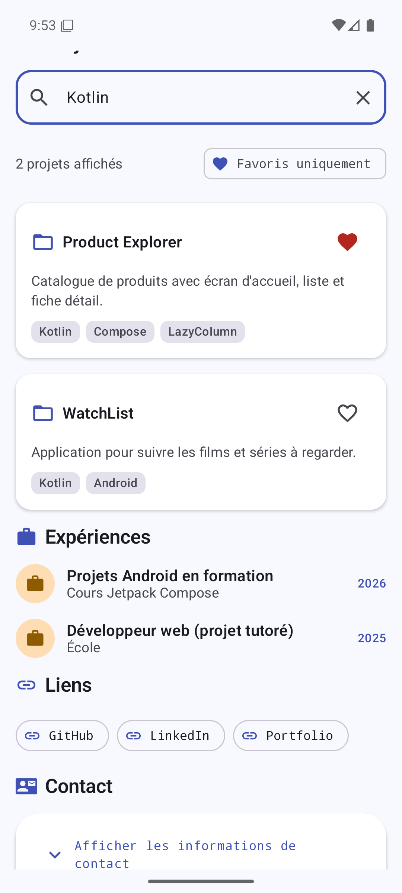

# Profil développeur interactif

## Description

Application Jetpack Compose qui présente mon profil de développeur. On peut maintenant rechercher un projet (titre, description ou technologie), ajouter ou retirer un projet des favoris, afficher uniquement les favoris et voir le nombre de projets affichés.

## États gérés

- texte de recherche (`searchQuery`)
- filtre favoris (`showOnlyFavorites`)
- projets favoris (`favoriteProjectIds`)
- liste affichée (`visibleProjects`)

## État local

L'affichage des informations de contact (`showDetails`) est géré dans `ContactSection` avec `rememberSaveable`. C'est un simple état visuel qui ne concerne que ce composant, donc pas besoin de le mettre dans le ViewModel.

## State Hoisting

`ProfileScreen` ne stocke aucun état : il reçoit les valeurs en paramètres et remonte les actions par des callbacks (`onSearchQueryChange`, `onToggleFavoriteFilter`, `onFavoriteClick`). C'est pour ça qu'il est stateless et qu'on peut l'utiliser directement dans les previews.

## ViewModel

`ProfileViewModel` garde l'état principal de l'écran et contient les actions qui le modifient (recherche, favori, filtre).

## StateFlow

Le ViewModel garde un `MutableStateFlow` privé et expose un `StateFlow` en lecture seule. `ProfileContainer` le collecte avec `collectAsState()`. Quand le ViewModel publie un nouvel état, Compose recompose l'écran automatiquement.

## Organisation du code

- `ProfileViewModel` : gère l'état et les actions
- `ProfileUiState` : regroupe l'état de l'écran et calcule la liste affichée
- `ProfileContainer` : relie le ViewModel à Compose
- `ProfileScreen` : affiche l'écran (stateless)
- `ProjectCard` : carte d'un projet avec bouton favori
- `ProjectSearchBar` : champ de recherche
- `ProjectFilterRow` : nombre de projets et filtre favoris
- `ContactSection` : contact avec état local

## Capture d'écran

